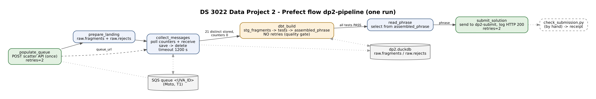
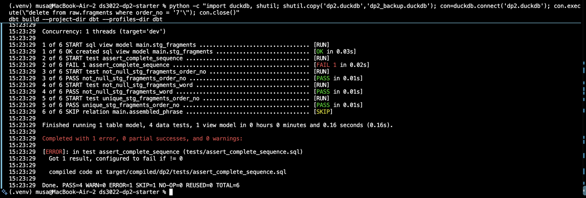
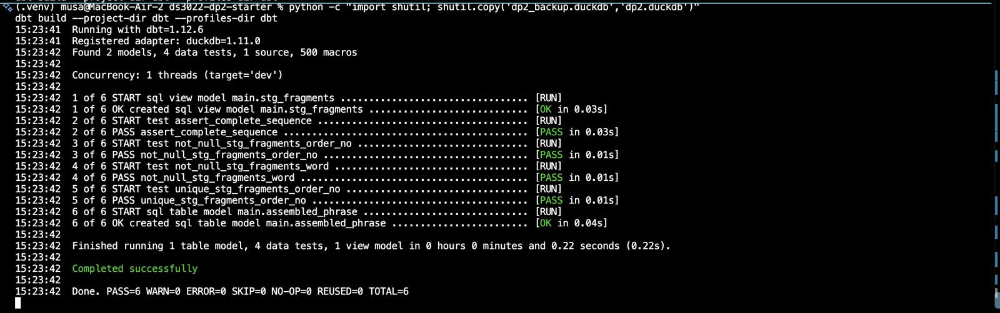
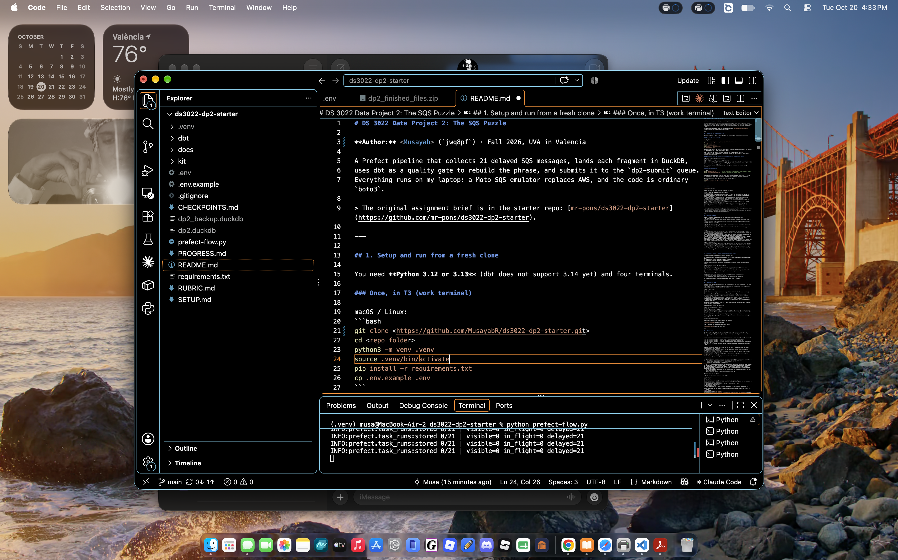
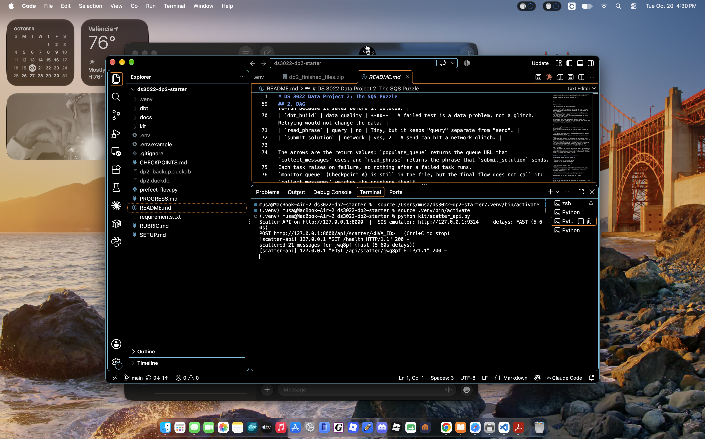
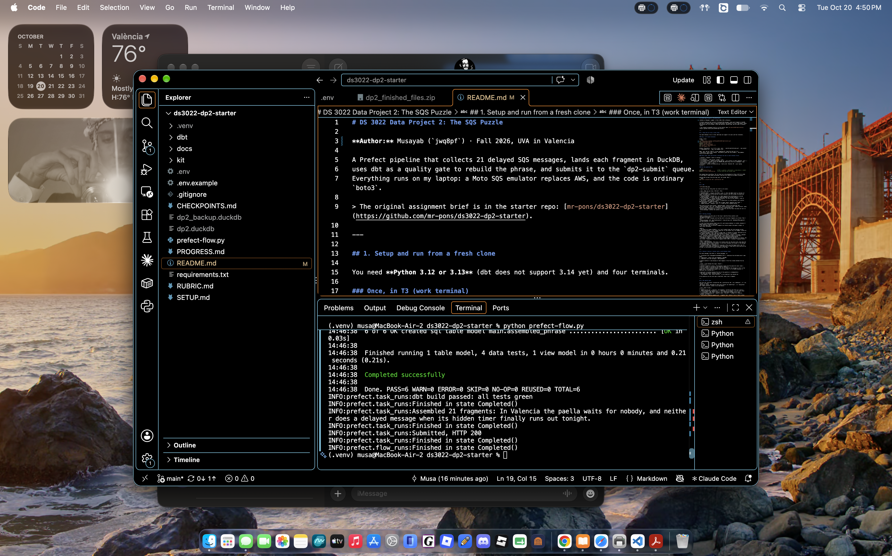

# DS 3022 Data Project 2: The SQS Puzzle

**Author:** Musayab (`jwq8pf`) · Fall 2026, UVA in Valencia

A Prefect pipeline that collects 21 delayed SQS messages, lands each fragment in DuckDB,
uses dbt as a quality gate to rebuild the phrase, and submits it to the `dp2-submit` queue.
Everything runs on my laptop: a Moto SQS emulator replaces AWS, and the code is ordinary `boto3`.

> The original assignment brief is in the starter repo: [mr-pons/ds3022-dp2-starter](https://github.com/mr-pons/ds3022-dp2-starter).

---

## 1. Setup and run from a fresh clone

You need **Python 3.12 or 3.13** (dbt does not support 3.14 yet) and four terminals.

### Once, in T3 (work terminal)

macOS / Linux:
```bash
git clone https://github.com/MusayabR/ds3022-dp2-starter.git
cd cd ds3022-dp2-starter
python3 -m venv .venv
source .venv/bin/activate
pip install -r requirements.txt
cp .env.example .env
```
Windows (PowerShell): `py -3.12 -m venv .venv`, `.venv\Scripts\Activate.ps1`, `pip install -r requirements.txt`, `copy .env.example .env`.

Open `.env` and set `UVA_ID` to your computing ID. Leave the rest as it is
(`DP2_FAST=1` gives 5-60 s delays, `DP2_FAST=0` gives the real 30-900 s, `DP2_CHAOS=1` turns on the chaos round).

### Every time: start the servers (activate the venv in each terminal first)

| Terminal | Command | Leave it running? |
|---|---|---|
| T1 · Emulator | `moto_server -p 9324` | yes |
| T2 · Scatter API | `python kit/scatter_api.py` | yes (restart it after changing `.env`) |
| T4 · Prefect | `prefect config set PREFECT_API_URL="http://127.0.0.1:4200/api"` then `prefect server start` | yes |
| T3 · Work | `python kit/smoke_test.py` → must print `Emulator OK` | your typing terminal |

### Run the pipeline (T3)

```bash
python prefect-flow.py            # POST -> collect -> dbt build -> read phrase -> submit
python kit/check_submission.py    # prints PASS and the receipt code
```

One command does everything. The run shows up in the dashboard at http://127.0.0.1:4200.
In fast mode it takes about one minute, and with full delays up to about 15 minutes.

Running dbt by hand (from the repo root, not inside `dbt/`):
```bash
dbt build --project-dir dbt --profiles-dir dbt
```

---

## 2. DAG



I made one task per thing that can **fail on its own**:

| Task | What can go wrong | Retries? | Why |
|---|---|---|---|
| `populate_queue` | network (the POST) | yes, 2 | Only the POST itself is retried. It never runs again once collecting has started, because a new POST purges the queue and starts a new puzzle. |
| `prepare_landing` | DuckDB file | no | Kept separate from collecting so a retried `collect_messages` can never wipe rows whose messages are already deleted. |
| `collect_messages` | timing, parsing, deleting | no (has its own timeout) | Safe to re-run because it saves before it deletes. |
| `dbt_build` | data quality | **no** | A failed test is a data problem, not a glitch. Retrying would not change the data. |
| `read_phrase` | query | no | Tiny, but it keeps "query" separate from "send". |
| `submit_solution` | network | yes, 2 | A send can hit a network glitch. |

The arrows are the return values: `populate_queue` returns the queue URL that `collect_messages` uses, and `read_phrase` returns the phrase that `submit_solution` sends.
Each task raises on failure, so nothing after a failed task runs.
`monitor_queue` (Checkpoint A) is still in the file, but the final flow does not call it: `collect_messages` watches the counters itself.

---

## 3. Polling strategy

**What I chose:** On every pass of the loop I read the three counters with `get_queue_attributes`
(visible, in flight, delayed) and log them next to how many fragments are stored. Then I call
`receive_message` with `WaitTimeSeconds=10` (long polling) and `MaxNumberOfMessages=10`, and take whatever is visible.

> I poll the three counters about every 10 s and receive whatever is visible, because it makes progress visible in the logs.
> The flow stops when 21 distinct fragments are stored **and** the queue is empty, or fails after 20 minutes.

**Why:**
- The delays are random (30-900 s), so I can't predict when the last message arrives. Watching the counters, I can **see** them fall in the Prefect log, for example `stored 13/21 | visible=0 in_flight=0 delayed=8`.
- Long polling means I don't spin in a tight loop: if nothing is visible, SQS waits up to 10 s before answering, and I get each message as soon as it is released.
- **Stop rule:** `count(distinct order_no) >= 21` **and** `visible + in_flight + delayed == 0`. Counting *distinct* fragments means a duplicate never makes me stop early. Requiring all counters at 0 means I never leave a dangling message behind.
- **Timeout:** 1200 s, longer than the 900 s maximum delay plus polling. If it passes, the task raises `TimeoutError: Only N/21 fragments after 1200 s` instead of hanging forever.

**What I rejected:**
- **(a) `time.sleep(900)` then drain.** It always waits for the worst case, even when the last message came out after 2 minutes. It also just *assumes* the timing: if one message were delayed longer, I would miss it.
- **Long polling alone, stopping at 21 received.** This uses the fewest calls, but "21 received" is the wrong stop condition: with duplicates it stops before every position has arrived. It also gives no counter evidence in the logs.

---

## 4. Receive → persist → delete (and a crash between steps)

For every message, the order in `collect_messages` is:

1. **receive** with `MessageAttributeNames=["All"]` (otherwise the attributes don't come back)
2. **persist**: `insert into raw.fragments` (DuckDB)
3. **delete** with that message's `ReceiptHandle`

I delete **after** I save because of what happens if the flow crashes between the two steps:

| Order | Crash between the steps | Result |
|---|---|---|
| receive → **delete → save** | the message is gone from the queue but never saved | **lost for good**, so the phrase can never be complete |
| receive → **save → delete** (mine) | the row is saved but the message is still in the queue; after the visibility timeout (30 s) it comes back | it is saved **twice**: a duplicate row, nothing lost |

A duplicate is harmless because the rest of the pipeline is **idempotent**:
- the stop rule counts `distinct order_no`
- `stg_fragments` uses `select distinct`, so two identical rows become one

So my pipeline can only ever gain a duplicate, never lose a fragment.

---

## 5. dbt quality gate

The flow runs `dbt build --project-dir dbt --profiles-dir dbt` (via `dbtRunner`). If `res.success` is false,
`dbt_build` raises `RuntimeError("dbt tests failed: not submitting")`, so `read_phrase` and `submit_solution` **never run on bad data**.

| File | What it does |
|---|---|
| `models/sources.yml` | declares `raw.fragments` (written by the flow) as a source |
| `models/staging/stg_fragments.sql` | `cast(order_no as integer)` so `10` sorts after `2`, `trim(word)`, and `select distinct` so a redelivered message counts once |
| `models/staging/schema.yml` | generic tests: `not_null` + `unique` on `order_no`, `not_null` on `word` |
| `tests/assert_complete_sequence.sql` | singular test: returns a row (= fails) unless there are exactly 21 fragments **and** `max - min + 1 = count` (no gaps) |
| `models/marts/assembled_phrase.sql` | one row: `fragment_count` and `string_agg(word, ' ' order by order_no)` |

dbt builds the staging model, runs all 4 tests, and only then builds the mart. If a test fails, the mart is **skipped**.

**How the tests protect the result:**

| Case in `raw.fragments` | Result |
|---|---|
| clean, 21 fragments | PASS=6 |
| fragment 7 missing | `assert_complete_sequence` FAILS (20 rows vs 21), mart skipped |
| exact duplicate of a row | PASS, correctly: `distinct` removes it, because it is just a redelivery |
| a second, different word for position 7 | `assert_complete_sequence` **and** `unique_stg_fragments_order_no` FAIL, mart skipped. This is a real conflict, so the gate must stop. |

**Proof the gate can fail**

I deleted fragment 7 from `raw.fragments` on purpose:



Then I restored the backup copy and ran it again:



---

## 6. Chaos round

In chaos mode (`DP2_CHAOS=1`) the scatter API sends **24** messages instead of 21:
21 fragments, plus 2 duplicates (at-least-once delivery), plus 1 poison message with `order_no = "?"` and **no** `word` attribute.

**What broke.** With the Session 10 code, a chaos run crashed part-way through collecting:
```
Task run 'collect_messages' - stored 15/21 | visible=0 in_flight=0 delayed=9
Task run 'collect_messages' - Task run failed with exception: KeyError('word')
Task run 'collect_messages' - Finished in state Failed("Task run encountered an exception KeyError: 'word'")
Flow run '...' - Finished in state Failed("Flow run encountered an exception: KeyError: 'word'")
```

**Why.** The poison message has `order_no` but no `word`. My old loop read `a["word"]["StringValue"]` with no guard,
so that line raised `KeyError: 'word'` and the whole flow failed. Even if I had just *skipped* it, without deleting it,
it would have come back every 30 s (visibility timeout). Then `in_flight` and `visible` would never reach 0, the stop rule
would never fire, and the run would end in a timeout. The duplicates were **not** a problem: the stop rule counts
`distinct order_no`, and `stg_fragments` uses `select distinct`.

**How I fixed it.**
1. `prepare_landing` now also creates `raw.rejects (message_id, attributes, received_at)`.
2. A new helper, `parse(msg)`, returns `(order_no, word)`, or `None` if:
   - an attribute is missing (`try` / `except KeyError`), or
   - `order_no` is not a number (`isdigit()`).

   The `'?'` therefore never reaches dbt, which would fail trying to cast it to an integer.
3. In the loop: if `parse` returns `None`, I log `Rejected malformed message <MessageId>` as a warning and insert it into `raw.rejects`. Otherwise it goes into `raw.fragments`.
4. `delete_message` sits **outside** the `if/else`, so every message is saved somewhere and **then deleted**.
   The bad message must be deleted and not just skipped, or it keeps coming back and the queue never empties.
   This is the same idea as a dead-letter queue on real AWS.

The stop rule did not change.

**Proof: two chaos runs in a row, both PASS.**

| | Run 1 | Run 2 |
|---|---|---|
| "Rejected malformed message" warning | `5b0c0589-7270-4207-89e1-150253db40bd` | `56136927-ffdf-43c5-b804-38e52b5b768f` |
| last collect line | `stored 21/21 \| visible=0 in_flight=0 delayed=0` | `stored 21/21 \| visible=0 in_flight=0 delayed=0` |
| `raw.fragments` rows / distinct `order_no` | 23 / 21 | 23 / 21 |
| `raw.rejects` rows | 1 | 1 |
| dbt | PASS=6 | PASS=6 |
| `check_submission.py` | PASS, receipt `BB4C661A65` | PASS, receipt `BB4C661A65` |

DuckDB query used for the counts (run after the flow has finished, then `con.close()`):
```python
import duckdb
con = duckdb.connect("dp2.duckdb")
print(con.execute("select count(*), count(distinct order_no) from raw.fragments").fetchall())
print(con.execute("select * from raw.rejects").fetchall())
con.close()
```




---

## 7. Roles of Prefect, dbt and DuckDB

| Tool | Its job here | What I'd lose without it |
|---|---|---|
| **Prefect** | Orchestration: the **E and L**. It runs the tasks in order, passes values between them, retries the network steps, logs every counter line, and shows each run in the dashboard. | I'd have one long script with no retries per step, no run history, and no way to see which step failed. |
| **DuckDB** | Storage: the landing zone (`raw.fragments`, `raw.rejects`) and the models dbt builds, all in one local file. | Fragments would only live in memory, so a crash would lose everything already deleted from the queue. dbt would also have nothing to test. |
| **dbt** | The **T plus the tests**: it types and de-duplicates (`stg_fragments`), checks the data (4 tests), and builds the phrase (`assembled_phrase`). It is the quality gate: nothing is submitted unless every test passes. | I'd rebuild the phrase in Python with no tests, so a missing or conflicting fragment would be submitted silently. |

---

## 8. Results

**Full-delay evidence run** (`DP2_FAST=0`, delays 30-900 s): the flow run is `Completed` in the Prefect dashboard.



**dbt output:** `Done. PASS=6 WARN=0 ERROR=0 SKIP=0 TOTAL=6` (see the screenshot in section 5).

**Receipt code:** `BB4C661A65`

Verify it with:
```bash
python kit/check_submission.py --verify jwq8pf prefect BB4C661A65    # -> VALID receipt
```

---

## 9. Repository hygiene

- This repo is a fork of the assignment repository. `kit/` is unchanged.
- `.gitignore` keeps out `.env`, `*.duckdb`, `dbt/target/`, `dbt/logs/` and log files. I checked `git status` before every push.
- Logging uses Prefect's `get_run_logger()` only. No log files are written or committed.
